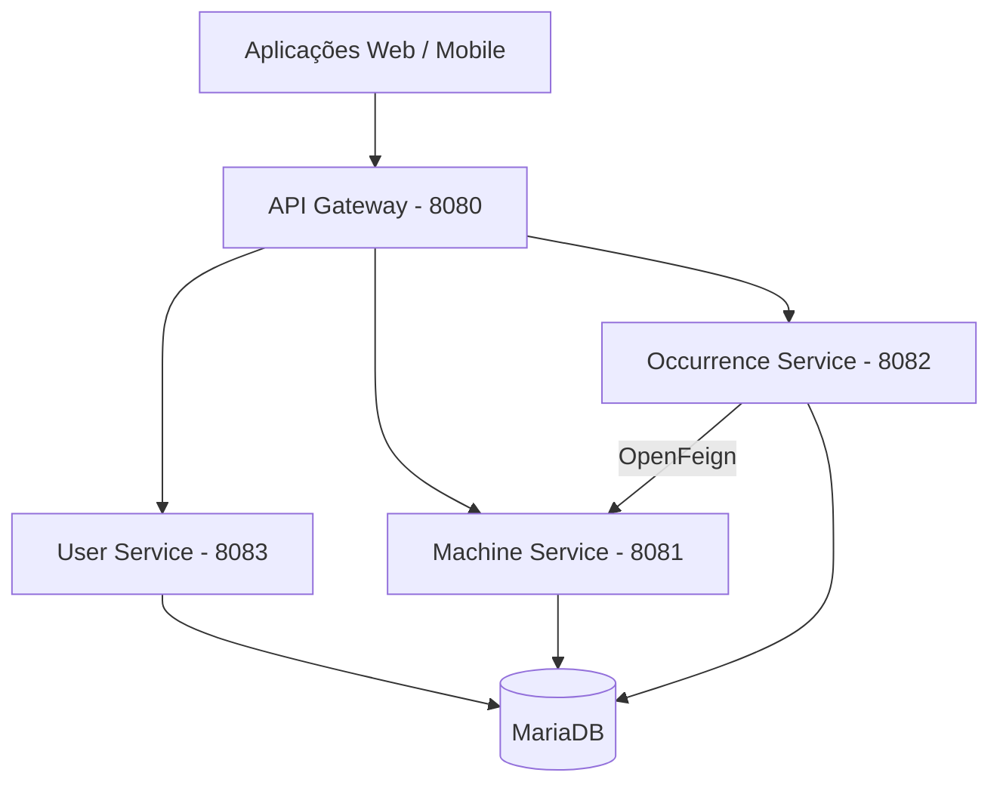

# BlueDev – Sistema de Gestão de Ocorrências

Projeto Integrador (PI) – Fatec | 6º Semestre – 2026

## Sobre o Projeto

O **BlueDev** é um sistema voltado à gestão de ocorrências e alertas corretivos e preventivos em empresas. Seu objetivo é facilitar a comunicação de problemas internos, organizar o acompanhamento das ocorrências e melhorar a rastreabilidade das ações realizadas.

A solução conta com aplicações Web e Mobile e está passando por uma evolução arquitetural, com a implementação de uma API baseada em microserviços utilizando Java e Spring Boot.

## Funcionalidades

- Registro de ocorrências pelos funcionários.
- Consulta e acompanhamento de ocorrências.
- Visualização detalhada das ocorrências.
- Administração de ocorrências por gestores.
- Cadastro, edição e exclusão de informações.
- Diferenciação de acesso entre usuários e administradores.
- Gerenciamento de máquinas.
- Autenticação de usuários.

## Arquitetura

O backend está organizado em uma arquitetura de microserviços, centralizando o acesso por meio de um API Gateway.

Cada serviço possui responsabilidades específicas:

| Serviço | Responsabilidade | Porta |
|---|---|---|
| API Gateway | Receber e encaminhar as requisições aos microserviços | 8080 |
| User Service | Gerenciamento e autenticação de usuários | 8083 |
| Machine Service | Gerenciamento de máquinas | 8081 |
| Occurrence Service | Gerenciamento de ocorrências | 8082 |
| MariaDB | Armazenamento dos dados | 3306 (interno) |

### Comunicação entre os serviços

- O frontend realiza as requisições através do API Gateway.
- O Gateway encaminha as requisições para o microserviço correspondente.
- O Occurrence Service utiliza OpenFeign para consultar o Machine Service e validar referências de máquinas.
- Os microserviços utilizam o MariaDB para persistência dos dados.

### Diagrama da arquitetura



## Tecnologias Utilizadas

### Backend

- **Java 21** – Linguagem de programação.
- **Spring Boot 4.1.2** – Desenvolvimento dos microserviços.
- **Spring Data JPA** – Persistência e acesso aos dados.
- **Spring Cloud Gateway** – Roteamento centralizado das requisições.
- **OpenFeign** – Comunicação HTTP entre microserviços.
- **Flyway** – Controle de versão e execução das migrations do banco.
- **Gradle** – Gerenciamento de dependências e build.
- **Lombok** – Redução de código repetitivo.

### Banco de Dados

- **MariaDB 10.11** – Banco de dados relacional.

### Infraestrutura

- **Docker** – Conteinerização das aplicações.
- **Docker Compose** – Orquestração dos containers.

### Frontend

- **PHP** – Backend da implementação Web original.
- **JavaScript (ES6)** – Funcionalidades dinâmicas.
- **HTML5 e CSS3** – Estrutura e estilização.
- **Flutter e Dart** – Desenvolvimento do aplicativo Mobile.

## Estrutura do Projeto

```text
PI_FATEC_2026_6_SEMESTRE/
│
├── microservicos/
│   ├── api-gateway/
│   │   ├── Dockerfile
│   │   └── src/
│   │
│   ├── user-service/
│   │   ├── Dockerfile
│   │   └── src/
│   │
│   ├── machine-service/
│   │   ├── Dockerfile
│   │   └── src/
│   │
│   └── occurrence-service/
│       ├── Dockerfile
│       └── src/
│
├── Bluedev - Web/
│   └── Front-end/
│
├── Bluedev - Mobile/
│   ├── lib/
│   └── pubspec.yaml
│
├── docker-compose.yml
└── README.md
```

## Instalação e Execução

### Pré-requisitos

Antes de iniciar o projeto, instale:

- [Git](https://git-scm.com/)
- [Docker Desktop](https://www.docker.com/products/docker-desktop/)
- Docker Compose (incluído no Docker Desktop).

### 1. Clonar o repositório

```bash
git clone https://github.com/seu-usuario/PI_FATEC_2026_6_SEMESTRE.git
```

Entre na pasta do projeto:

```bash
cd PI_FATEC_2026_6_SEMESTRE
```

### 2. Iniciar os microserviços

Certifique-se de que o Docker Desktop esteja em execução.

Na raiz do projeto, execute:

```bash
docker compose up -d --build
```

Esse comando realiza o build das imagens e inicia os seguintes serviços:

- MariaDB;
- Machine Service;
- Occurrence Service;
- User Service;
- API Gateway.

Na primeira execução, o processo pode demorar mais devido ao download das imagens e dependências e à compilação dos projetos.

### 3. Verificar os containers

Para verificar se os serviços estão em execução:

```bash
docker compose ps
```

Para acompanhar os logs:

```bash
docker compose logs -f
```

Para visualizar os logs de um serviço específico:

```bash
docker compose logs -f machine-service
```

### 4. Acessar a API

O API Gateway centraliza o acesso aos microserviços.

Endereço-base:

```text
http://localhost:8080
```

Principais rotas:

| Serviço | Endpoint |
|---|---|
| Usuários | `/api/usuarios/**` |
| Máquinas | `/api/maquinas/**` |
| Ocorrências | `/api/ocorrencias/**` |

### 5. Acessar a documentação Swagger

A documentação dos três microserviços está centralizada no Gateway.

Acesse:

```text
http://localhost:8080/swagger-ui.html
```

A interface permite consultar os endpoints e executar requisições diretamente pela documentação.

### 6. Acessar o banco de dados

O MariaDB pode ser acessado por ferramentas como DBeaver.

Configurações para conexão local:

| Campo | Valor |
|---|---|
| Host | `localhost` |
| Porta | `3307` |
| Database | `bluedev` |
| Usuário | `bluedev` |
| Senha | `bluedev` |

As tabelas são gerenciadas por migrations do Flyway.

### 7. Parar os serviços

Para parar e remover os containers:

```bash
docker compose down
```

Os dados do banco permanecem armazenados no volume Docker.

**Atenção:** não utilize `docker compose down -v` se desejar preservar os dados, pois esse comando também remove os volumes.

Para iniciar novamente:

```bash
docker compose up -d
```

## Equipe

| Frente | Responsáveis | Status |
|---|---|---|
| Web | Caio Betegheli, Matheus Guedes | Em melhoramento |
| Mobile | Davi Boneli, Melissa Vieira | Em desenvolvimento |
| Backend / Microserviços | Matheus Guedes | Implementação e integração |

## Público-alvo

- **Funcionários:** registram ocorrências e comunicam problemas internos.
- **Administradores e gestores:** acompanham, validam e gerenciam as ocorrências.
- **Empresas:** utilizam a solução para organizar processos corretivos e preventivos.

## Objetivos do Projeto

- Melhorar a comunicação de problemas internos.
- Aumentar a eficiência na resolução de ocorrências.
- Garantir rastreabilidade das ações realizadas.
- Facilitar o gerenciamento de máquinas e ocorrências.
- Disponibilizar acesso por diferentes plataformas.
- Evoluir a arquitetura do sistema para uma estrutura baseada em microserviços.

## Status do Projeto

**Em desenvolvimento.**

- **Web:** aplicação desenvolvida, com melhorias contínuas.
- **Mobile:** aplicação Flutter em desenvolvimento.
- **Backend:** microserviços implementados com Java e Spring Boot.
- **API Gateway:** implementado e integrado aos três microserviços.
- **Banco de dados:** MariaDB integrado, com migrations gerenciadas pelo Flyway.
- **Docker:** conteinerização e execução integrada dos serviços implementadas.